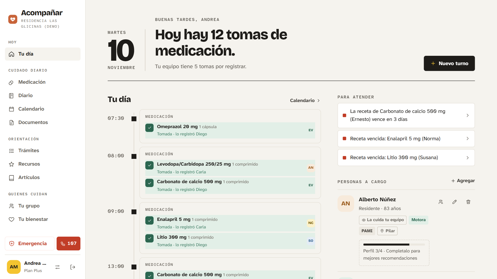
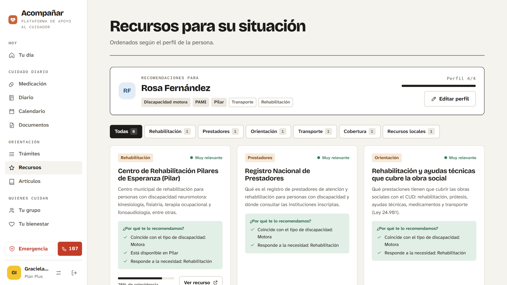
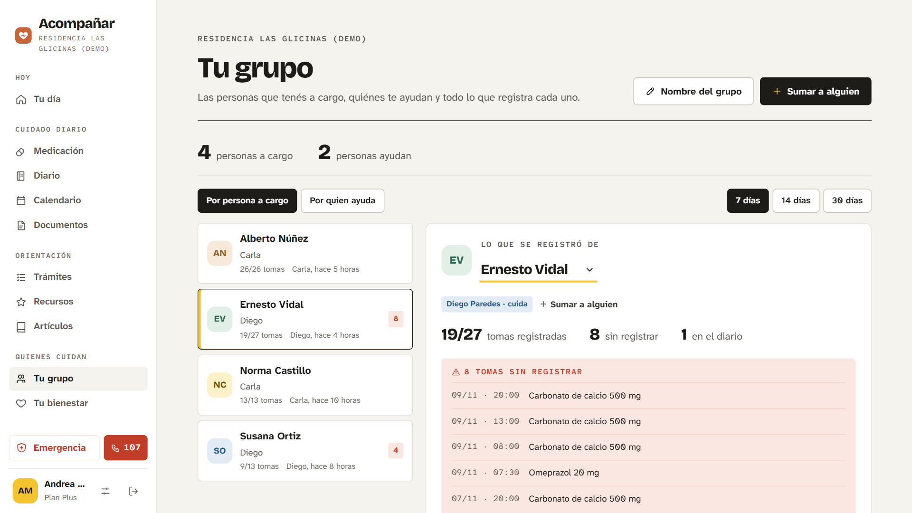
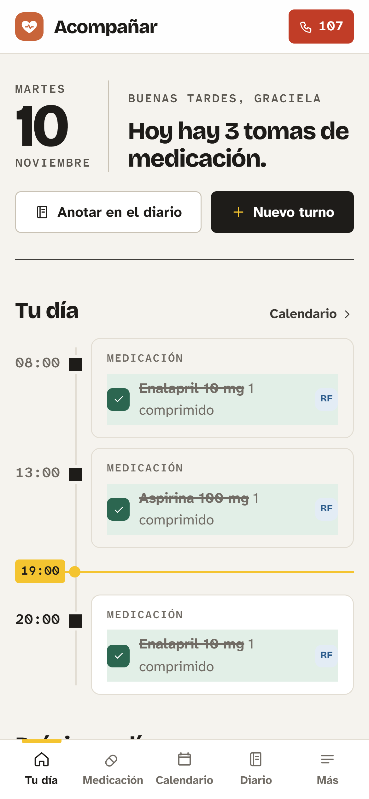

# Acompañar

Plataforma web que ayuda a quienes cuidan a una persona con discapacidad en Argentina a organizar el día a día, coordinar al grupo que cuida y encontrar recursos y trámites recomendados según el perfil de la persona.

Proyecto Final de Ingeniería en Informática · Facultad de Ingeniería · Universidad del Salvador (USAL) · 2026.



## Qué hace

- **Tu día:** turnos y tomas de medicación de todas las personas a cargo, en una sola línea.
- **Tu grupo:** cada integrante tiene su cuenta (cuidador u observador) y el dueño ve qué registró cada uno.
- **Recursos recomendados:** motor híbrido propio en C# (perfil de la persona + valoraciones de otros cuidadores) que explica cada sugerencia.
- **Trámites del CUD** paso a paso, **artículos** de especialistas con su fuente, **diario**, **documentos**, **tu bienestar** y **emergencia al 107**.
- **Planes:** Básico (gratis), Intermedio (USD 5/mes) y Plus (USD 15/mes). El pago está simulado.

| Recomendaciones | Tu grupo | Celular |
|---|---|---|
|  |  |  |

## Tecnologías

| Capa | Tecnología |
|---|---|
| Frontend | React 19 + Vite |
| Backend | ASP.NET Core (.NET 10), ASP.NET Core Identity + JWT |
| Datos | SQL Server + Entity Framework Core (migraciones code-first) |
| Pruebas | xUnit (68 pruebas automatizadas) |

## Requisitos

- [.NET SDK 10](https://dotnet.microsoft.com/download)
- [Node.js 22 o superior](https://nodejs.org/)
- SQL Server Express (instancia `.\SQLEXPRESS`) o cualquier SQL Server al que se pueda conectar
- Herramienta de Entity Framework: `dotnet tool install --global dotnet-ef`

## Instalación y configuración

```bash
git clone https://github.com/valenquiroz/Tesis.git
cd Tesis
```

1. Copiar `backend/Cuida.Api/appsettings.Local.example.json` como `backend/Cuida.Api/appsettings.Local.json`.
2. En ese archivo, reemplazar `Jwt:Key` por una clave aleatoria de **al menos 32 caracteres**.
   Si SQL Server no está en `.\SQLEXPRESS`, ajustar `ConnectionStrings:DefaultConnection`.
3. (Opcional) Completar `Admin` para crear una cuenta administradora y `Correo` para enviar mails de recuperación de contraseña.
4. Frontend: si la API no corre en `http://localhost:5282`, copiar `frontend/.env.example` como `frontend/.env` y cambiar `VITE_API_URL`.

`appsettings.Local.json` y `.env` están en el `.gitignore`: los secretos nunca se suben al repositorio.

## Ejecución

```bash
# 1. Crear la base de datos (una sola vez)
cd backend/Cuida.Api
dotnet ef database update

# 2. Backend con los datos de demostración → http://localhost:5282 (Swagger en /swagger)
dotnet run --launch-profile http --Demo:Cargar=true

# 3. Frontend, en otra terminal → http://localhost:5173
cd frontend
npm install
npm run dev
```

En Windows, después del paso 1, `iniciar.bat` levanta backend y frontend juntos.

### Cuentas de demostración

Con `--Demo:Cargar=true` se cargan familias, una residencia, recursos y artículos. Las contraseñas siguen el patrón `Nombre123!`:

| Cuenta | Contraseña | Para ver |
|---|---|---|
| `gracielaibarra@gmail.com` | `Graciela123!` | Familia con plan Plus: recomendaciones de su mamá Rosa, trámites, artículos |
| `andreamolina@gmail.com` | `Andrea123!` | Dueña de una residencia (Plus): Tu grupo y lo que registró cada cuidador |
| `federicoledesma@gmail.com` | `Federico123!` | Plan Básico: qué queda fuera del plan gratuito |
| `martasuarez@gmail.com` | `Marta123!` | Cuidadora contratada en dos familias |

Son cuentas ficticias que solo existen en la base local.

## Pruebas

```bash
cd backend
dotnet test
```

## Estructura

```
backend/Cuida.Api     API REST: controladores, servicios (motor de recomendación, accesos, planes), modelos y migraciones
backend/Cuida.Tests   pruebas automatizadas (xUnit)
frontend/             interfaz web en React
docs/                 documentación técnica y capturas
tesis/                documento de la tesis (LaTeX) y PDF final
```

## Documentación

- Tesis completa: [`tesis/Tesis_Final_ValentinaQuiroz.pdf`](tesis/Tesis_Final_ValentinaQuiroz.pdf)
- Notas técnicas del desarrollo: [`docs/CLAUDE.md`](docs/CLAUDE.md)

## Estado

Prototipo funcional que se ejecuta en un entorno local. La publicación en Azure (App Service + Azure SQL Database) y la integración con una pasarela de pagos real quedan como próximos pasos.

## Autora

**Valentina Sol Quiroz** · valentinasol.quiroz@usal.edu.ar

## Licencia

[MIT](LICENSE)
